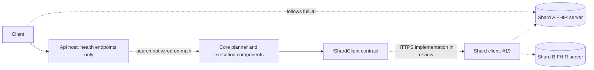
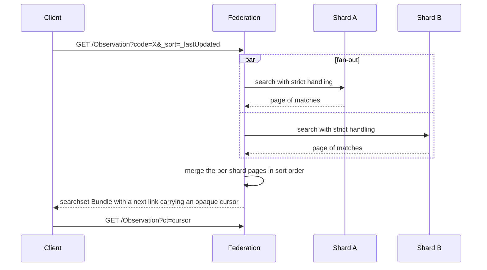

<div align="center">
  
  <h1>Ignixa Federation</h1>
  <p>
    <b>One read-only FHIR R4 search endpoint in front of many FHIR servers</b>
  </p>

[](https://dotnet.microsoft.com/)
[](LICENSE)
[](https://github.com/brendankowitz/fhir-federation-service/actions/workflows/ci.yml)
[](https://hl7.org/fhir/R4/)
[](#project-status-by-capability)

</div>

---

> **Project status.** Core search planning and execution components are implemented and covered by scripted unit tests. The authenticated search API and verified HTTPS shard backend are still in review ([#17](https://github.com/brendankowitz/fhir-federation-service/pull/17), [#19](https://github.com/brendankowitz/fhir-federation-service/pull/19)). On `main`, the API still serves health checks only; it does not yet expose federated search or connect the Core components to live shards. This is early implementation work, not a production-ready release. The [design spec](docs/superpowers/specs/2026-11-19-fhir-federation-service-design.md) defines intended behavior; the [status table](#project-status-by-capability) distinguishes implemented, in-review, and planned work.

---

## Overview

Ignixa Federation is being built to present N FHIR R4 servers, called shards, as one read-only search endpoint. A client will send an ordinary FHIR search to the federation, which will send it to the shards, merge the answers, and return one `searchset` Bundle with paging links. The Core planner and execution stages exist, but the API does not wire them into a search endpoint on `main`.

Large datasets outgrow a single FHIR server and its single write primary. Splitting the data across servers fixes the storage limit but leaves every client to query each server and combine the results. The federation does that work once, in one place, with defined behaviour for paging, ordering, and failure.

The v1 service is designed to be read-only: it will never write to a shard, and a request it cannot answer completely will fail rather than return a partial Bundle. These are design guarantees, not yet end-to-end behavior of the current host.

## ✨ Key Features

The components below describe what is implemented in Core and what remains in review or planned. Core tests use scripted shard clients; they do not prove that the current API runs these behaviors end to end. See the [status table](#project-status-by-capability).

### Implemented in Core

* Search planning, parameter rewriting, and reference classification.
* Unsorted and `_lastUpdated` sorted page executors, exact federated count execution, and page-scoped include / reverse-include execution.
* Distributed forward-chain and depth-one reverse-chain (`_has`) resolution.

These are Core capabilities, not API features yet. In particular, `Api` does not call `ForwardChainResolver`, `RevIncludePageExecutor`, or `SortedPageExecutor`.

### In review

* Authenticated read-only FHIR R4 search routes, `/metadata`, and Redis-backed continuation storage ([#17](https://github.com/brendankowitz/fhir-federation-service/pull/17)).
* Verified HTTPS shard access and shard configuration ([#19](https://github.com/brendankowitz/fhir-federation-service/pull/19)).

FHIR R4 is the only certified release today. The VP1 follow-up will make search version-provider based, selected by `Federation:Version`.

## Project status by capability

| Capability | Status | Spec |
|---|---|---|
| .NET solution, shard registry contract, identity types, and options validation | Done ([#4](https://github.com/brendankowitz/fhir-federation-service/pull/4)) | [§4.2](docs/superpowers/specs/2026-11-19-fhir-federation-service-design.md#42-shard-registry), [§12.1](docs/superpowers/specs/2026-11-19-fhir-federation-service-design.md#121-projects) |
| CI, health endpoints, and telemetry foundations | Done ([#4](https://github.com/brendankowitz/fhir-federation-service/pull/4)) | [§14](docs/superpowers/specs/2026-11-19-fhir-federation-service-design.md#14-observability), [§16](docs/superpowers/specs/2026-11-19-fhir-federation-service-design.md#16-phases) |
| Query planner, classifier, rewriter, and reference classifier | Done ([#10](https://github.com/brendankowitz/fhir-federation-service/pull/10), [#12](https://github.com/brendankowitz/fhir-federation-service/pull/12)) | [§6](docs/superpowers/specs/2026-11-19-fhir-federation-service-design.md#6-search-planning), [§7.7](docs/superpowers/specs/2026-11-19-fhir-federation-service-design.md#77-reference-classifier-shared) |
| Unsorted primary page executor | Done ([#9](https://github.com/brendankowitz/fhir-federation-service/pull/9)) | [§7.1](docs/superpowers/specs/2026-11-19-fhir-federation-service-design.md#71-primary-search-and-emission-order) |
| Forward include, reverse include, distributed forward chains, and `_has` | Done ([#13](https://github.com/brendankowitz/fhir-federation-service/pull/13), [#15](https://github.com/brendankowitz/fhir-federation-service/pull/15), [#18](https://github.com/brendankowitz/fhir-federation-service/pull/18)) | [§7.5](docs/superpowers/specs/2026-11-19-fhir-federation-service-design.md#75-chains-and-_has-depth-1), [§7.6](docs/superpowers/specs/2026-11-19-fhir-federation-service-design.md#76-includes-and-revincludes-targeted-per-page) |
| Sorted `_lastUpdated` page executor | Done ([#16](https://github.com/brendankowitz/fhir-federation-service/pull/16)) | [§7.3](docs/superpowers/specs/2026-11-19-fhir-federation-service-design.md#73-merge-sorted) |
| Exact federated count execution | Done ([#14](https://github.com/brendankowitz/fhir-federation-service/pull/14)) | [§7.1](docs/superpowers/specs/2026-11-19-fhir-federation-service-design.md#71-primary-search-and-emission-order), [§7.2](docs/superpowers/specs/2026-11-19-fhir-federation-service-design.md#72-count-only) |
| Authenticated FHIR R4 search API, `/metadata`, and Redis continuations | In review ([#17](https://github.com/brendankowitz/fhir-federation-service/pull/17)) | [§5](docs/superpowers/specs/2026-11-19-fhir-federation-service-design.md#5-request-surface), [§7.4](docs/superpowers/specs/2026-11-19-fhir-federation-service-design.md#74-continuation-tokens), [§9](docs/superpowers/specs/2026-11-19-fhir-federation-service-design.md#9-capabilities), [§10](docs/superpowers/specs/2026-11-19-fhir-federation-service-design.md#10-security) |
| Verified HTTPS shard backend and configuration | In review ([#19](https://github.com/brendankowitz/fhir-federation-service/pull/19)) | [§6.2](docs/superpowers/specs/2026-11-19-fhir-federation-service-design.md#62-backend-strictness-fail-closed-on-dropped-filters), [§9.2](docs/superpowers/specs/2026-11-19-fhir-federation-service-design.md#92-backend-profiles), [§10.2](docs/superpowers/specs/2026-11-19-fhir-federation-service-design.md#102-backend-credentials) |
| Sample client | Done ([#8](https://github.com/brendankowitz/fhir-federation-service/pull/8)); scripted tests only | [samples/README.md](samples/README.md) |
| Live backend compatibility and differential federation tests | Planned | [§15](docs/superpowers/specs/2026-11-19-fhir-federation-service-design.md#15-testing) |
| Load tests at 16 and 50 shards | Planned | [§3](docs/superpowers/specs/2026-11-19-fhir-federation-service-design.md#3-constraints), [§15](docs/superpowers/specs/2026-11-19-fhir-federation-service-design.md#15-testing) |
| Search version-provider selection via `Federation:Version` (VP1) | Planned | [§17](docs/superpowers/specs/2026-11-19-fhir-federation-service-design.md#17-left-to-the-builder) |
| Write placement, import/export, and shard rebalancing | Proposed for vNext; not implemented | [Write placement](docs/vnext/write-placement.md), [Import and export](docs/vnext/import-export.md), [vNext overview](docs/vnext/README.md) |

## Architecture

`Core` contains the domain contracts, planner, and execution components, with no HTTP code. On `main`, `Shards` has the shard activity instrumentation but not the verified HTTP client. `Api` currently maps only health endpoints; its search pipeline and shard client are not wired.



The `Core` components are exercised with scripted clients, not live shard servers. The dotted path is not a running search flow on `main`. See [docs/architecture](docs/architecture/README.md) for the design diagram and the spec for the complete target architecture.

## How a search runs

This is the target flow for a sorted search across two shards, not a request the current host can serve. The sorted executor exists in `Core`, but the API does not call it; `ForwardChainResolver` and `RevIncludePageExecutor` are likewise not wired into the API. The unsorted executor is also a Core component, not an exposed search route. See [§7.1](docs/superpowers/specs/2026-11-19-fhir-federation-service-design.md#71-primary-search-and-emission-order), [§7.3](docs/superpowers/specs/2026-11-19-fhir-federation-service-design.md#73-merge-sorted), and [§7.4](docs/superpowers/specs/2026-11-19-fhir-federation-service-design.md#74-continuation-tokens) for intended behavior.



## Quickstart

Prerequisite: the .NET SDK version in [global.json](global.json), currently 11.0.100. If the `dotnet` on your PATH resolves a different SDK, run the `dotnet` that has 11.0.100 installed.

```sh
git clone https://github.com/brendankowitz/fhir-federation-service.git
cd fhir-federation-service
dotnet restore Ignixa.Federation.slnx
dotnet build Ignixa.Federation.slnx -c Release
dotnet test --solution Ignixa.Federation.slnx -c Release
```

Run the host and check the health endpoints. Both return 200. The host runs in the foreground, so use two terminals.

Terminal 1, run the host:

```sh
dotnet run --project src/Ignixa.Federation.Api --urls http://localhost:5201
```

Terminal 2, check health:

```sh
curl http://localhost:5201/health/live
curl http://localhost:5201/health/ready
```

The sample client builds with the solution. Print its usage with `dotnet run --project samples/Ignixa.Federation.SampleClient -c Release -- --help`; its tests run with `dotnet test --project test/Ignixa.Federation.SampleClient.UnitTests/Ignixa.Federation.SampleClient.UnitTests.csproj -c Release`. The host on `main` does not serve searches yet, so the sample cannot run against a live federation. See [samples/README.md](samples/README.md).

Docker instructions are in [deploy/README.md](deploy/README.md).

## Configuration

`Core` defines and validates `FederationOptions`, but `Api/Program.cs` does not bind or register these options. On `main`, `appsettings.json` contains only `"Federation": { "Shards": [] }`; the host ignores that section. The following are the actual keys represented by the Core options types, not a claim that the current host consumes them:

```text
Federation:
  Shards[]: Id, Alias, BaseUrl, Profile, Auth, LinkBaseAliases[]
    Auth: Type, Resource, ClientId, TenantId, SecretName
  ProxyReads
  ChainResolution: Default, Passthrough[]
  Limits: DefaultPageSize, MaxPageSize, MaxChainKeys, MaxChainSourceRows,
          MaxIncludesPerPage, BackendCallsPerShard, MaxResponseBytes,
          MaxParallelBackendCalls, ShardCountWarningThreshold
  Timeouts: Request, BackendCall, ChainSubquery
  Tokens: MaxInlineTokenBytes, SlidingLifetime, AbsoluteLifetime
```

`Auth.Type` supports `ManagedIdentity` and `ClientCredentials`; `SecretName` points to an externally held secret, never a secret value. Defaults and validation are defined in the Core options types. The in-review API/backend work ([#17](https://github.com/brendankowitz/fhir-federation-service/pull/17), [#19](https://github.com/brendankowitz/fhir-federation-service/pull/19)) is not part of this `main` snapshot. `Federation:Version` is not currently an option; it is planned for VP1.

## Repository layout

```text
.github/       CI workflow, issue templates, pull request template
assets/        Logo
deploy/        Dockerfile and compose.yaml
docs/          Documentation, including the design spec
samples/
  Ignixa.Federation.SampleClient/   Standalone wire-contract client
src/
  Ignixa.Federation.Core/     Domain logic, no HTTP or hosting
  Ignixa.Federation.Shards/   Backend transport (HTTPS implementation in review)
  Ignixa.Federation.Api/      ASP.NET Core host (health endpoints on main)
test/
  Ignixa.Federation.Core.UnitTests/
  Ignixa.Federation.Shards.UnitTests/
  Ignixa.Federation.Tests.Integration/
  Ignixa.Federation.SampleClient.UnitTests/
tools/         Developer scripts
```

## Documentation

* [Documentation index](docs/README.md)
* [Architecture](docs/architecture/README.md)
* [Guides](docs/guides/README.md)
* [vNext](docs/vnext/README.md)
* [Design spec](docs/superpowers/specs/2026-11-19-fhir-federation-service-design.md)

## Contributing

Read [CONTRIBUTING.md](CONTRIBUTING.md) for the branch and pull request flow. [AGENTS.md](AGENTS.md) holds the conventions, boundaries, and commands for humans and coding agents.

## Security

Report vulnerabilities privately. See [SECURITY.md](SECURITY.md).

## License

Ignixa Federation is released under the [MIT License](LICENSE).
