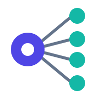
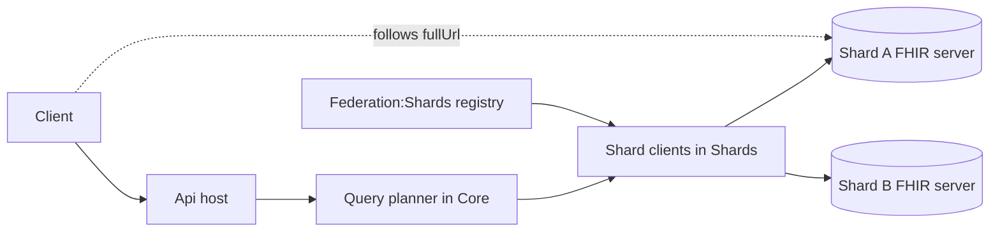
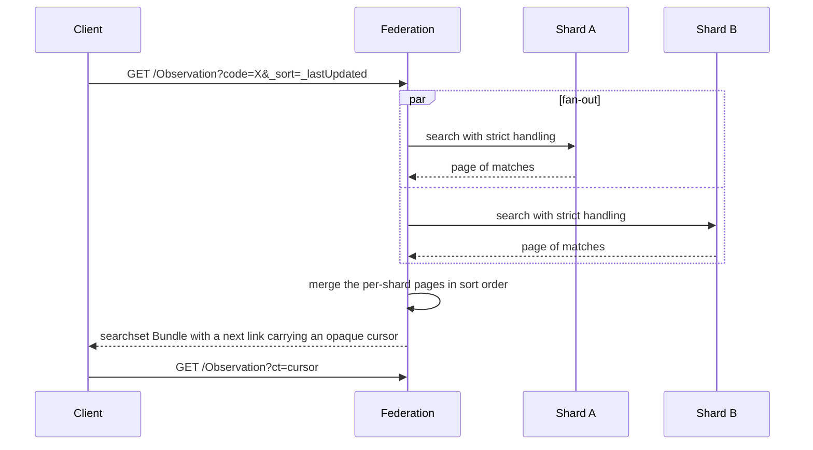

<div align="center">
  
  <h1>Ignixa Federation</h1>
  <p>
    <b>One read-only FHIR R4 search endpoint in front of many FHIR servers</b>
  </p>

[](https://dotnet.microsoft.com/)
[](LICENSE)
[](https://github.com/brendankowitz/fhir-federation-service/actions/workflows/ci.yml)
[](https://hl7.org/fhir/R4/)
[](#project-status-by-capability)

</div>

---

> **Project status.** Ignixa Federation is at the scaffold stage. The repository has three .NET projects, two health endpoints, telemetry names, CI, and a Docker skeleton, plus the shard contract, registry model, and options validation in `Core`. It does not search anything yet and is not usable for production. The [design spec](docs/superpowers/specs/2026-11-19-fhir-federation-service-design.md) is the plan, and the [status table](#project-status-by-capability) says what exists.

---

## Overview

Ignixa Federation presents N FHIR R4 servers, called shards, as one read-only search endpoint. A client sends an ordinary FHIR search to the federation. The federation sends the search to the shards, merges the answers, and returns one `searchset` Bundle with paging links.

Large datasets outgrow a single FHIR server and its single write primary. Splitting the data across servers fixes the storage limit but leaves every client to query each server and combine the results. The federation does that work once, in one place, with defined behaviour for paging, ordering, and failure.

The service is read-only. It never writes to a shard. A request it cannot answer completely fails with an error instead of returning a partial Bundle. The spec defines each of these behaviours.

## ✨ Key Features

These are design goals from the spec, not shipped behaviour. The [status table](#project-status-by-capability) shows which of them exist.

### 🔎 Search across shards

* Type-level FHIR R4 search with `GET [base]/[type]` and `POST [base]/[type]/_search`.
* Cross-shard `_include` and `_revinclude`, and chained search and `_has` at depth 1.
* Optional global `_sort=_lastUpdated` with retryable paging. Unsorted search is the default.

### 🧭 Honest results

* Every entry's `fullUrl` is the resource's real URL on its shard, so same-id resources on different shards stay distinct.
* A failing shard fails the request. The federation does not return a partial Bundle.
* The CapabilityStatement advertises only what the federation guarantees.

### 🛡️ Safe by default

* Read-only. Writes, transactions, and `$operations` are refused.
* SMART on FHIR tokens are refused. Callers authorise with role claims.
* Shard credentials go only to the shard they belong to. Redirects are not followed.

## Project status by capability

| Capability | Status | Spec |
|---|---|---|
| Solution scaffold | Done | [§12.1](docs/superpowers/specs/2026-11-19-fhir-federation-service-design.md#121-projects) |
| CI | Done | [§16](docs/superpowers/specs/2026-11-19-fhir-federation-service-design.md#16-phases) Phase 0 |
| Health endpoints (`/health/live`, `/health/ready`) | Done | [§14](docs/superpowers/specs/2026-11-19-fhir-federation-service-design.md#14-observability) |
| Shard contract and registry model | Done | [§4.2](docs/superpowers/specs/2026-11-19-fhir-federation-service-design.md#42-shard-registry), [§12.1](docs/superpowers/specs/2026-11-19-fhir-federation-service-design.md#121-projects) |
| Query planning (classifier, rewriter, reference classifier) | Planned | [§6](docs/superpowers/specs/2026-11-19-fhir-federation-service-design.md#6-search-planning), [§7.7](docs/superpowers/specs/2026-11-19-fhir-federation-service-design.md#77-reference-classifier-shared) |
| HTTP shard client and Microsoft FHIR Server profile | Planned | [§6.2](docs/superpowers/specs/2026-11-19-fhir-federation-service-design.md#62-backend-strictness-fail-closed-on-dropped-filters), [§9.2](docs/superpowers/specs/2026-11-19-fhir-federation-service-design.md#92-backend-profiles) |
| Resilience and auth to shards | Planned | [§8](docs/superpowers/specs/2026-11-19-fhir-federation-service-design.md#8-failure-semantics), [§10.2](docs/superpowers/specs/2026-11-19-fhir-federation-service-design.md#102-backend-credentials) |
| API host with search stages | Planned | [§5](docs/superpowers/specs/2026-11-19-fhir-federation-service-design.md#5-request-surface), [§6.3](docs/superpowers/specs/2026-11-19-fhir-federation-service-design.md#63-stages), [§7.1](docs/superpowers/specs/2026-11-19-fhir-federation-service-design.md#71-primary-search-and-emission-order) |
| `_include` and `_revinclude` | Planned | [§7.6](docs/superpowers/specs/2026-11-19-fhir-federation-service-design.md#76-includes-and-revincludes-targeted-per-page) |
| Chained search and `_has` | Planned | [§7.5](docs/superpowers/specs/2026-11-19-fhir-federation-service-design.md#75-chains-and-_has-depth-1) |
| `_lastUpdated` merge ordering and `_total` | Planned | [§7.3](docs/superpowers/specs/2026-11-19-fhir-federation-service-design.md#73-merge-sorted), [§7.2](docs/superpowers/specs/2026-11-19-fhir-federation-service-design.md#72-count-only) |
| Ignixa backend profile | Planned | [§9.2](docs/superpowers/specs/2026-11-19-fhir-federation-service-design.md#92-backend-profiles) |
| Load tests (16 and 50 shards) | Planned | [§15](docs/superpowers/specs/2026-11-19-fhir-federation-service-design.md#15-testing) item 6 |
| Sample client | Planned | [samples/README.md](samples/README.md) |
| Developer guide | Planned | [docs/guides/README.md](docs/guides/README.md) |
| vNext (import and export, writes, shard balancing) | Planned | [§13](docs/superpowers/specs/2026-11-19-fhir-federation-service-design.md#13-extension-path-v2) |

## Architecture

The `Core` project holds the domain logic and has no HTTP code. The `Shards` project talks to the backends. The `Api` project hosts the endpoints.



The dotted line is the design: a client can read a resource directly from its shard by following `fullUrl`. See [docs/architecture](docs/architecture/README.md) for the components and the spec for the full diagram.

## How a search runs

This is the planned flow for a sorted search that spans two shards. An unsorted search queries the first shard alone and fans out only if that shard does not fill the page. The spec describes both in [§7.1](docs/superpowers/specs/2026-11-19-fhir-federation-service-design.md#71-primary-search-and-emission-order), [§7.3](docs/superpowers/specs/2026-11-19-fhir-federation-service-design.md#73-merge-sorted), and [§7.4](docs/superpowers/specs/2026-11-19-fhir-federation-service-design.md#74-continuation-tokens).



## Quickstart

Prerequisite: the .NET SDK version in [global.json](global.json), currently 11.0.100. If the `dotnet` on your PATH resolves a different SDK, run the `dotnet` that has 11.0.100 installed.

```sh
git clone https://github.com/brendankowitz/fhir-federation-service.git
cd fhir-federation-service
dotnet restore Ignixa.Federation.slnx
dotnet build Ignixa.Federation.slnx -c Release
dotnet test --solution Ignixa.Federation.slnx -c Release
```

Run the host and check the health endpoints. Both return 200. The host runs in the foreground, so use two terminals.

Terminal 1, run the host:

```sh
dotnet run --project src/Ignixa.Federation.Api --urls http://localhost:5201
```

Terminal 2, check health:

```sh
curl http://localhost:5201/health/live
curl http://localhost:5201/health/ready
```

Docker instructions are in [deploy/README.md](deploy/README.md).

## Configuration

The planned shard registry is the `Federation` section of the host configuration. This is the shape from [spec §4.2](docs/superpowers/specs/2026-11-19-fhir-federation-service-design.md#42-shard-registry).

```jsonc
"Federation": {
  "ProxyReads": true,
  "ChainResolution": {
    "Default": "Distributed",
    "Passthrough": [ "Observation.subject:Patient", "Encounter.subject:Patient", "Condition.subject:Patient" ]
  },
  "Shards": [
    { "Id": "east", "Alias": "k7q2", "BaseUrl": "https://fhir-east.internal/", "Profile": "MicrosoftFhirServer",
      "Auth": { "Type": "ManagedIdentity", "Resource": "https://fhir-east.internal" },
      "LinkBaseAliases": [] },
    { "Id": "west", "Alias": "p9xm", "BaseUrl": "https://fhir-west.internal/", "Profile": "MicrosoftFhirServer",
      "Auth": { "Type": "ManagedIdentity", "Resource": "https://fhir-west.internal" } }
  ]
}
```

The host does not read the `Federation` section today. `Core` defines and validates this shape (`FederationOptions`, `FederationOptionsValidator`, `ShardRegistry`), and a unit test binds the example above, but nothing registers it in the host yet. `appsettings.json` contains an empty `Shards` array, and the host ignores it. The spec leaves final key names to the implementation ([§17](docs/superpowers/specs/2026-11-19-fhir-federation-service-design.md#17-left-to-the-builder)).

## Repository layout

```text
.github/       CI workflow, issue templates, pull request template
assets/        Logo
deploy/        Dockerfile and compose.yaml
docs/          Documentation, including the design spec
samples/       Planned sample client
src/
  Ignixa.Federation.Core/     Domain logic, no HTTP or hosting
  Ignixa.Federation.Shards/   HTTP access to backends
  Ignixa.Federation.Api/      ASP.NET Core host
test/
  Ignixa.Federation.Core.UnitTests/
  Ignixa.Federation.Shards.UnitTests/
  Ignixa.Federation.Tests.Integration/
tools/         Dev scripts, empty today
```

## Documentation

* [Documentation index](docs/README.md)
* [Architecture](docs/architecture/README.md)
* [Guides](docs/guides/README.md)
* [vNext](docs/vnext/README.md)
* [Design spec](docs/superpowers/specs/2026-11-19-fhir-federation-service-design.md)

## Contributing

Read [CONTRIBUTING.md](CONTRIBUTING.md) for the branch and pull request flow. [AGENTS.md](AGENTS.md) holds the conventions, boundaries, and commands for humans and coding agents.

## Security

Report vulnerabilities privately. See [SECURITY.md](SECURITY.md).

## License

Ignixa Federation is released under the [MIT License](LICENSE).
