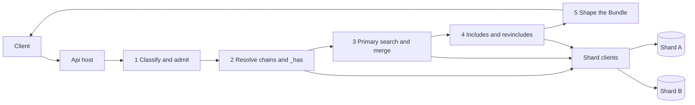

# Architecture

The [design spec](../superpowers/specs/2026-11-19-fhir-federation-service-design.md) is the source of truth. This page summarises the structure and points to the spec sections. If the two disagree, the spec wins.

Only the scaffold is built today. The components below describe the design, and each is marked with what exists.

## Components

| Project | Role | Built today |
|---|---|---|
| `Ignixa.Federation.Core` | Domain logic: planner, rewriter, reference classifier, merge, budget, token snapshot model ([§12.1](../superpowers/specs/2026-11-19-fhir-federation-service-design.md#121-projects)). No HTTP or hosting code. | `FederationTelemetry` (the `ActivitySource` and `Meter` named `Ignixa.Federation`). |
| `Ignixa.Federation.Shards` | The shard registry, the HTTP shard client, backend profiles, auth handlers, resilience, and capability fetch ([§12.1](../superpowers/specs/2026-11-19-fhir-federation-service-design.md#121-projects)). No ASP.NET dependency. | `ShardActivity.StartBackendCall(alias, stage)`. |
| `Ignixa.Federation.Api` | The host: minimal APIs, authentication and authorisation, response shaping, dependency injection, OpenTelemetry ([§12.1](../superpowers/specs/2026-11-19-fhir-federation-service-design.md#121-projects)). | `/health/live` and `/health/ready`. |

## Request flow

A search passes through five stages ([§6.3](../superpowers/specs/2026-11-19-fhir-federation-service-design.md#63-stages)).

`Core` holds the logic these stages use: classification, rewriting, reference classification, merge and budget ([§12.1](../superpowers/specs/2026-11-19-fhir-federation-service-design.md#121-projects)). The `Api` host runs the stages and does authentication and role authorisation. Every call to a shard goes through the shard client in `Shards`.

## Where the spec defines each part

| Topic | Spec section |
|---|---|
| Identity and references | [§4](../superpowers/specs/2026-11-19-fhir-federation-service-design.md#4-identity-and-references) |
| Request surface | [§5](../superpowers/specs/2026-11-19-fhir-federation-service-design.md#5-request-surface) |
| Search planning | [§6](../superpowers/specs/2026-11-19-fhir-federation-service-design.md#6-search-planning) |
| Execution, merge, tokens, chains, includes | [§7](../superpowers/specs/2026-11-19-fhir-federation-service-design.md#7-execution) |
| Failure semantics | [§8](../superpowers/specs/2026-11-19-fhir-federation-service-design.md#8-failure-semantics) |
| Capabilities and backend profiles | [§9](../superpowers/specs/2026-11-19-fhir-federation-service-design.md#9-capabilities) |
| Security | [§10](../superpowers/specs/2026-11-19-fhir-federation-service-design.md#10-security) |
| Response shaping | [§11](../superpowers/specs/2026-11-19-fhir-federation-service-design.md#11-response-shaping) |
| Observability | [§14](../superpowers/specs/2026-11-19-fhir-federation-service-design.md#14-observability) |
| Testing | [§15](../superpowers/specs/2026-11-19-fhir-federation-service-design.md#15-testing) |

Work after v1 is planned in [vNext](../vnext/README.md) and in [§13](../superpowers/specs/2026-11-19-fhir-federation-service-design.md#13-extension-path-v2).
