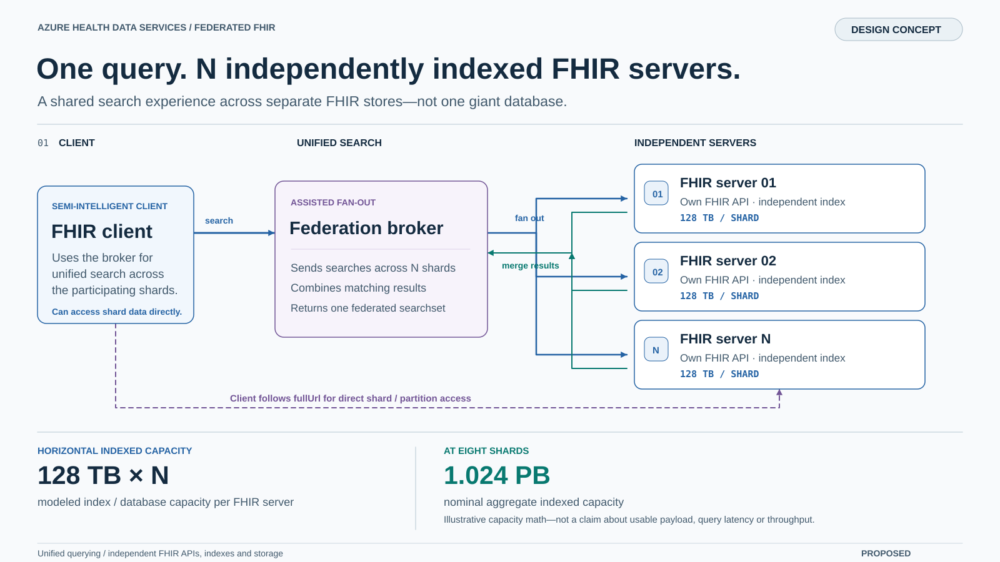
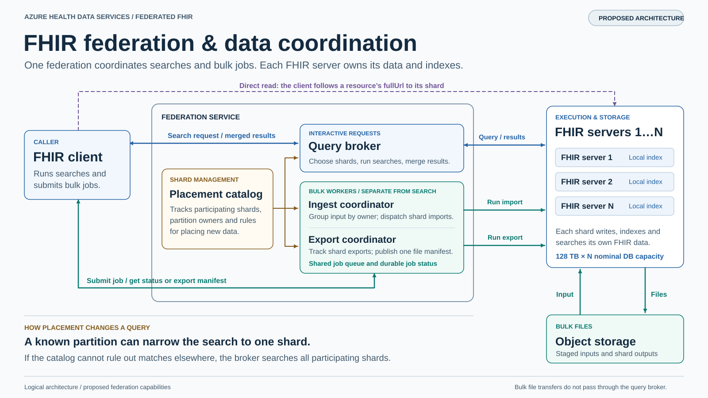

# Gateway architecture

The gateway is a read-only FHIR R4 search endpoint in front of independent servers. It is not a database that imports their resources or assigns global IDs. **The owner is part of the identity**: if two servers each return `Patient/42`, the response contains two resources with different `fullUrl` values. The JSON inside each entry retains its original references. [Design §§4–5][design] · [Searchset response tests][entries].

## One query, separate indexes

The gateway combines **search results**, not indexes. Each participating FHIR server searches its own data. The client gets one searchset and can use an entry’s `fullUrl` to identify the resource at its owner.

[Open the querying-at-scale diagram at full size](public/architecture/fhir-federated-querying-at-scale.svg). The figure’s **128 TB per shard × 8 = 1.024 PB** is illustrative nominal database capacity, not measured usable storage, latency or throughput.

## Follow one search

For a request such as `GET /Observation?status=final`, assuming the type and parameter are supported:

1. **API selects a generation.** The route captures the current search service before authentication, starts one request budget, and checks signing freshness. A cold host returns 503 before reading the body or contacting a shard. Health probes bypass this path. [Route and middleware registration][routes].
2. **API authorizes; Core plans.** The host validates the caller and checks the primary type grant. The planner parses controls, checks the capability view and determines which occurrences to keep, remove or replace. Joins require grants on the additional types. Planner acceptance alone is not execution: the dispatcher can return 501 for a valid shape. [Grant evaluation][grants] · [Core planner][planner] · [API dispatch][dispatch].
3. **The transport does owner-specific work.** The host supplies the request's capability view and budget to a shard-client factory, not the caller token. Physical sends (including retries) and response bytes draw on that same budget. For unsorted pages the executor emits matches in registry order; a needed shard failure is not reported as a complete page. [Transport contract][transport] · [Unsorted execution tests][execution].
4. **API writes the searchset.** Matches retain their owner; authorized includes and outcome entries carry their own entry modes. A successor, if needed, is a gateway link bound to this caller, not a backend cursor. For reads use the owner URL or an eligible owner-qualified alternate, not `GET /Observation/42` without an owner. [Response tests][entries] · [Continuation tests][continuations] · [Read routes][reads].

## Why metadata and search agree

A **generation** is the search service and serialized CapabilityStatement prepared from one capability view and a snapshot of startup settings. The host builds both before publishing either. A request uses the pair it captured; replacing the generation does not switch its registry mid-request. A withdrawal makes new capability-dependent requests cold, without falling back to an older startup view. [Generation implementation][state] · [Publication tests][publication].

`GET /metadata` reads the current generation without a caller grant. Readiness also considers caller signing keys, so metadata can succeed while a protected search returns 503. Even warm metadata describes admitted resources and parameters, not every possible combination of them. Compare the [search support matrix](status.md) before diagnosing an unsupported shape as a shard outage. [Metadata endpoint][metadata] · [Signing readiness tests][signing].

For the components required to produce a generation, see [Host and backend binding](binding.md). For the meaning of a shard's URL and alias, see [Shard registry](shards.md).

## Proposed coordination, not a write API

The design sketch below extends the search model with placement rules, ingest and export workers, a job queue and bulk file storage. **Those are proposed capabilities, not supported gateway operations.** The implemented gateway serves read-only search and eligible owner-qualified reads. It does not accept writes, assign incoming resources to shards, or coordinate bulk imports and exports.

[Open the proposed coordination diagram at full size](public/architecture/fhir-federation-coordination.svg). For what callers can actually send today, use the [search support matrix](status.md).

[design]: ../superpowers/specs/2026-11-19-fhir-federation-service-design.md
[entries]: ../../test/Ignixa.Federation.Tests.Integration/Responses/SearchsetResponseTests.cs
[routes]: ../../src/Ignixa.Federation.Api/Search/PrimarySearchEndpoints.cs
[grants]: ../../src/Ignixa.Federation.Api/Authorization/CallerAccess.cs
[planner]: ../../src/Ignixa.Federation.Core/Search/SearchPlanner.cs
[dispatch]: ../../src/Ignixa.Federation.Api/Search/PrimarySearch.cs
[transport]: ../../src/Ignixa.Federation.Api/Search/IShardClientFactory.cs
[execution]: ../../test/Ignixa.Federation.Core.UnitTests/Execution/UnsortedPageExecutorFailureTests.cs
[continuations]: ../../test/Ignixa.Federation.Tests.Integration/Search/PrimarySearchContinuationTests.cs
[reads]: ../../test/Ignixa.Federation.Tests.Integration/Reads/ProxiedReadRouteTests.cs
[state]: ../../src/Ignixa.Federation.Api/Search/PrimarySearchState.cs
[publication]: ../../test/Ignixa.Federation.Tests.Integration/Search/PrimarySearchCapabilityPublicationTests.cs
[metadata]: ../../src/Ignixa.Federation.Api/Metadata/MetadataEndpoints.cs
[signing]: ../../test/Ignixa.Federation.Tests.Integration/Search/SigningReadinessTests.cs
