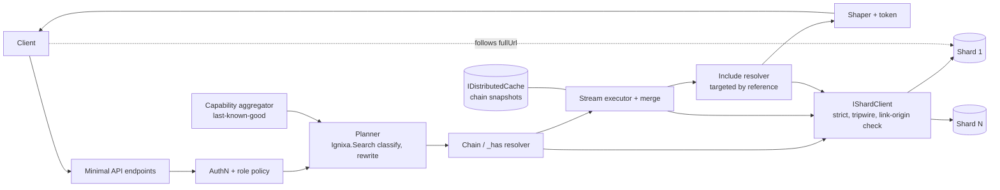

# Ignixa Federation — Design

**Status:** Draft v4 — two review rounds by GPT-6.2 Astra (FHIR semantics, algorithms) and Claude Fable 5.2 (scope, architecture, security, operability), then owner decisions D1–D7 (§18). Awaiting final approval.
**Date:** 2026-11-19
**Repo:** `brendankowitz/fhir-federation-service`
**Supersedes:** ADR 2506 "Fanout Broker Query Service" (`microsoft/fhir-server`, branch `personal/bkowitz/copilot/broker`) and its prototype (`brendankowitz/fhir-server#55`, branch `copilot/fix-53`).

Items marked **[call]** are author decisions informed by the reviews, for the owner to check.

---

## 1. Intent

Present **N FHIR servers as shards behind one read-only FHIR search endpoint**. Clients issue ordinary FHIR R4 searches against the federation; it fans out to the shards, resolves `_include`/`_revinclude` and chained / reverse-chained (`_has`) search across shards, merges the results, and returns one `searchset` Bundle. Every entry's `fullUrl` is the resource's real URL on its shard, so entries from different shards are always distinguishable and a client can follow `fullUrl` to fetch the resource from its server.

Long term this layer is one half of the petabyte-scale story: per-server storage work (search-parameter filtering, defrag, schema optimisation, raw-resource split) raises how much each shard holds; the federation multiplies shards and removes the single-write-primary ceiling. Write placement is the v2 bridge (§13).

### Why rebuild instead of reviving the prototype

The 2025 prototype (≈14.5K LOC) proved the execution patterns but was coupled to `Microsoft.Health.Fhir.Core`, re-serialised parsed expression trees back into query strings (its main defect class — `ab7f9d0ae` "Fix inconsistent _has query reconstruction"), and never defined identity, ordering, totals, failure or authorisation semantics.

## 2. Goals, non-goals, anti-goals

### Goals (v1)

1. Type-level FHIR R4 search (`GET [base]/[type]?…`, `POST [base]/[type]/_search`) across N shards.
2. Cross-shard `_include` / `_revinclude` with explicit parameters; forward chains and `_has` at depth 1, resolved distributed (default) or passthrough (operator-asserted).
3. Global `_sort=_lastUpdated` (asc/desc) with retryable paging; unsorted search as the default.
4. `fullUrl` = the resource's URL on its shard; optional federation-proxied read for clients that cannot reach the shards.
5. A CapabilityStatement that advertises only what the federation guarantees.
6. Fail-closed semantics: no silently incomplete or over-broad result.
7. Differential tests against an oracle (§15).

### Non-goals (v1)

- Writes of any kind; transactions; batch; conditional operations; `$operations`.
- A shard-less logical identity (`[base]/Patient/123` meaning "wherever it lives") — see §4.
- System-level search (`[base]?_type=`), shard-qualified search, `_history` lists, vread.
- `_sort` on anything other than `_lastUpdated`; multi-key sort.
- `_elements` and `_summary` other than `count` (400).
- Multi-level chains, `_include:iterate`, wildcard includes, include-overflow paging, canonical-reference includes/chains, chains through contained resources.
- SMART on FHIR authorisation of any kind (§10.1); partial-results opt-in.
- Custom SearchParameter reconciliation across shards (base-spec parameters only).
- Mixed FHIR versions (all shards R4).

### Anti-goals

- Silently incomplete or over-broad results (a dropped filter, a skipped shard, a capped chain, a truncated include) presented as correct.
- Backend credentials visible to clients, or sent to any host other than the shard they belong to.
- The federation's service credential letting a caller read data the caller's own role does not allow (confused deputy).
- Unbounded backend work, memory or cost from one client request.

## 3. Constraints

- .NET 11, ASP.NET Core Minimal APIs, central package management, warnings-as-errors, nullable, xUnit + Shouldly + NSubstitute — Ignixa conventions (`brendankowitz/ignixa-fhir` `AGENTS.md`).
- Ignixa consumed **only via published NuGet** (`0.6.82` at time of writing): `Ignixa.Abstractions`, `Ignixa.Specification`, `Ignixa.Serialization`, `Ignixa.Search`, `Ignixa.FhirPath`. `Ignixa.Api`, `.Application`, `.Domain`, `.DataLayer.*` are not published and must not be depended on. (`Ignixa.Search` references `Microsoft.AspNetCore.Http.Abstractions`; acceptable.)
- Shards are standard FHIR R4 REST servers over HTTPS. **v1 certified backends: Microsoft FHIR Server / Azure Health Data Services (primary), then Ignixa** (D3). Each certified backend has a verified `BackendProfile` (§9.2) and a compatibility run.
- **Size envelope (D6):** designed, tested and documented for up to 16 shards; load-tested at 16 and 50. 16 is a soft, documented limit (configurable), not a hard cap: sorted, chained and include queries need every shard, so all-shard availability is ≈98.4% at 16 shards and ≈95% at 50 (at 99.9% per shard), and each such page costs one backend call per shard. For scale, with storage items 1–4 roughly 4 shards of 128 TB hold 1 PiB, so 16 shards cover ≈4 PiB. One federation per deployment; no multi-tenancy.

## 4. Identity and references

### 4.1 Model: server-scoped identity, FHIR-standard references (D1)

- **A resource's identity is `(shard, type, id)`**, expressed as its absolute URL on the shard: `{shardBaseUrl}/{type}/{id}`. Ids need not be unique across shards; two `Patient/123`s on different shards are two resources with two `fullUrl`s. There is no duplicate detection because duplicates are not an error.
- **References follow standard FHIR semantics:**
  - a **relative** reference (`Patient/123`) inside a resource on shard A refers to `Patient/123` **on shard A**;
  - an **absolute** reference to a known shard base (`https://fhir-west.internal/Patient/123`, or a `LinkBaseAliases` form) refers to that resource on that shard;
  - any other absolute reference is foreign and is never resolved by the federation.
- **Data-loading requirement (documented):** a resource referenced relatively must exist on the referencing shard. Shared reference data (Practitioner, Organization, Location, Medication) is either present on each shard that references it, or referenced by absolute URL. Patient-compartment placement fits naturally.
- This makes includes **targeted** (each reference names exactly one shard) and keeps resource content untouched.

### 4.2 Shard registry

```jsonc
"Federation": {
  "ProxyReads": true,
  "ChainResolution": {
    "Default": "Distributed",
    "Passthrough": [ "Observation.subject:Patient", "Encounter.subject:Patient", "Condition.subject:Patient" ]
  },
  "Shards": [
    { "Id": "east", "Alias": "k7q2", "BaseUrl": "https://fhir-east.internal/", "Profile": "MicrosoftFhirServer",
      "Auth": { "Type": "ManagedIdentity", "Resource": "https://fhir-east.internal" },
      "LinkBaseAliases": [] },
    { "Id": "west", "Alias": "p9xm", "BaseUrl": "https://fhir-west.internal/", "Profile": "MicrosoftFhirServer",
      "Auth": { "Type": "ManagedIdentity", "Resource": "https://fhir-west.internal" } }
  ]
}
```

- `BaseUrl` is client-visible (it forms `fullUrl`). `Alias` is a short, stable, URL-safe name used in the federation-proxied read route, the `source-shard` extension and logs.
- `LinkBaseAliases` lists other base forms the shard is known by (custom domain, private-link host); references and backend links in any listed form are normalised to `BaseUrl`.
- Shard **ordinal** = registry position; it defines unsorted emission order and the sort tie-break.
- Registry version = content hash of `(Id, Alias, BaseUrl, LinkBaseAliases, Profile, ordinal)` **[call]**. Static configuration in v1.

## 5. Request surface

| Request | v1 behaviour |
|---|---|
| `GET [base]/metadata` | Federated CapabilityStatement (§9). |
| `GET [base]/[type]?…` | Federated search. |
| `POST [base]/[type]/_search` | Federated search (form body). |
| `POST [base]/[type]` | 405 — this is *create*. |
| `GET [base]/shards/{alias}/[type]/[id]` | Federation-proxied read on one shard, when `ProxyReads` is enabled (§5.1). |
| `GET [base]/[type]?ct={token}` | Next page. Any other search parameter alongside `ct` → 400. |
| `GET [base]/[type]/[id]` | 400 — ambiguous without a shard; OperationOutcome points at `fullUrl` or the proxied route. |
| `[base]?_type=…`, `[base]/shards/{alias}/[type]?…`, vread, `_history` | 501 with OperationOutcome (v2). |
| PUT / PATCH / DELETE / `$op` | 405 / 501 with OperationOutcome. |

JSON only in v1 (`application/fhir+json`); `_format=xml` → 415 **[call]**.

### 5.1 Proxied read

For clients that can reach the federation but not the shards (network or credentials). `GET [shard]/[type]/[id]` with the federation's credential, after the caller's role authorises the type (§10.1). The response body is returned unmodified, with `Content-Location` set to the resource's shard URL (its `fullUrl`); relative references in it therefore resolve against the shard, as they should. Disabled with `ProxyReads: false` for deployments where every client reads shards directly.

## 6. Search planning

### 6.1 Principle: plan on the parse tree, execute on raw parameter occurrences

- **Analysis** uses `Ignixa.Search` (`QueryParameterParser` → `SearchOptionsBuilder`; `ParameterTrace` gives per-parameter key syntax, chain segments and modifiers) against the **federated parameter set** to classify each occurrence: plain, chain, `_has`, include, revinclude, sort, result-control, unsupported.
- **Execution** never serialises an expression tree. A `QueryRewriter` keeps, drops or adds **raw parameter occurrences** of the client request. Untouched occurrences are forwarded with their original key text and original (still-encoded) value text.
- **Alignment risk (riskiest assumption):** the parser URL-decodes values, drops empty ones, and `ParameterTrace.Ordinal` counts search parameters only. The rewriter must align each raw occurrence to its trace entry independently of the parser's normalisation. Retired first, in Phase 0 (§16).
- **Result controls are owned by the federation**, not by `SearchOptionsBuilder` (which clamps `_count=0` to 1 and rejects `_total=estimate`): `_count`, `_sort`, `_total`, `_summary`, `_elements`, `_include`, `_revinclude`, `ct`.
- **Unsupported parameters or modifiers → 400 regardless of `Prefer: handling` (D7).** The federation never silently ignores a predicate. `Bundle.link[self]` lists exactly the predicates applied.

### 6.2 Backend strictness (fail closed on dropped filters)

- **Guard:** every backend search carries `Prefer: handling=strict`. Both certified backends honour it (Microsoft FHIR Server via `SearchOptionsFactory`; Ignixa via its `UnsupportedParams` handling) and return 400 rather than dropping a parameter.
- **Startup probe:** each shard is probed with an unknown parameter under strict handling and must return 400; otherwise it is not-ready.
- **Tripwire:** on initial searches the shard client compares the decoded parameter multiset sent with the backend's `self` link; a missing occurrence is a shard failure (§8). This catches only backends or intermediaries that ignore `Prefer`; continuation pages are not compared.
- **Semantic certification:** the compatibility corpus (§15) includes data where dropping either of two AND occurrences, a modifier, or one OR alternative changes the answer. That, not `self`, is the evidence that a backend applies what it echoes.

### 6.3 Stages

```text
1. Classify + admission check        (federated parameter set, role authorisation, budget)
2. Resolve chains / _has              (sub-queries → per-shard key sets → per-shard rewritten params)
3. Primary search                     (per-shard streams → merge → page cut)
4. Includes / revincludes             (from this page's matches only; targeted by reference)
5. Shape                              (fullUrl, links, outcomes, total, token)
```

## 7. Execution

### 7.1 Primary search and emission order

- **Unsorted (default):** emission order = shard ordinal, then the backend's order within the shard. Query the **first unexhausted shard alone** with `_count` = remaining page size; if it does not fill the page, query **all remaining unexhausted shards in parallel** and emit in ordinal order. Results from shard *k* are never emitted before shards *< k* are exhausted. A shard's failure fails the request **only if emission reaches it**; a speculative call that fails after the page is filled is discarded. Broad queries usually touch one or two shards; selective ones cost two rounds and depend on all shards.
- **`_sort=_lastUpdated` / `-_lastUpdated`:** all shards in parallel (bounded concurrency, default 16); k-way merge (§7.3).
- Backend requests carry the shard's rewritten parameters, the federation's `_count` per stream, and never `_include`/`_revinclude` (resolved by the federation, §7.6).
- `_elements`, and `_summary` other than `count` → 400 in v1.
- **`_total`:** `none`/absent → omitted. `accurate` or `estimate` → parallel count-only request to **every** shard, summed only if every shard's profile certifies exact counts for the query shape; otherwise 400 `not-supported`. Any count failure fails the request.

### 7.2 Count-only

`_count=0` and `_summary=count` normalise to one count-only plan: `Bundle.total`, no entries, no paging links. Total = sum of per-shard counts (identities are server-scoped, so shards never double-count), only when every shard's profile certifies exact counts for the query shape; otherwise 400 `not-supported`. Chains resolve first.

### 7.3 Merge (sorted)

- A **stream** is one backend request sequence for one shard; v1 has exactly one stream per shard (no split requests, §7.5).
- Per-stream fetch size `F = min(N, max(⌈2N/K⌉, 20))` for page size `N` and `K` streams, with lazy further fetches **[call]**. Federation `_count` max 100, default 20.
- The merge needs a **head or proof of exhaustion from every active stream** before emitting each result; short or empty backend pages are followed via `next`.
- **Total order:** `(lastUpdated, shardOrdinal, positionInStream)`. Within a shard, the backend's order is authoritative.
- **Order certification:** ordering is certified per backend profile (§9.2), including returned-instant precision and tie stability across backend pages. Microsoft FHIR Server's SQL provider derives `_lastUpdated` from the resource surrogate id and pages by keyset (`(sort value…, ResourceSurrogateId)` in `ContinuationToken`), which is what certification relies on. At runtime each stream's returned instants must be monotone; a violation is a backend contract failure (§8).
- **No buffered resources are kept between requests** (§7.4).

### 7.4 Continuation tokens

Goal: retry-safe and scale-out-safe without a page cache, distributed locks, or resource content at rest.

- **Snapshot:** each token is an immutable, Data-Protection-encrypted snapshot: format version, issued-at, binding hash, effective plan (classified parameters, rewritten parameters per shard, resolved chain key sets), page size, registry hash, hash of the parameter definitions the query resolved, and per stream `(replayable backend request, lastEmittedKey, exhausted)`. `lastEmittedKey` = `(lastUpdated, type/id)` for sorted streams, `type/id` for unsorted.
- **Redemption is re-execution:** re-issue each stream's backend request, skip entries up to and including `lastEmittedKey`, continue. Redeeming twice performs the same computation. If `lastEmittedKey` is no longer on the re-fetched backend page → 410 "restart the search" **[call]**.
- **Replayable backend requests are required** and certified per profile. Microsoft FHIR Server's keyset `ct` is stateless and replayable. For streams started with POST `_search`, the shard client re-POSTs the parameters of the backend's `next` link to `[type]/_search` after the origin check (`NextLinkRedemption`), because certified backends render `next` as a GET URL carrying every parameter (≈45 KB for 1,000 chain keys, past Kestrel's 8 KB request-line default).
- **Storage:** snapshots ≤ `MaxInlineTokenBytes` (2 KB) travel in the token — no server state. Larger ones (chain key sets) are stored encrypted in `IDistributedCache` under a random id; they hold ids and timestamps only. On successor issue, the predecessor's TTL drops to 60 s.
- **Binding:** hash of (`iss`, `sub`, `oid`/`client_id`, sorted role claims). Mismatch → 403.
- **Lifetime:** 15 min sliding, 60 min absolute **[call]** (D5). Expired or missing → 410. Unprotect failure → 400.
- **Invalidation:** only if a shard in this token's streams changed, or a parameter definition this query resolved changed.
- **Scale-out:** multi-instance deployments need a shared Data Protection key ring (fixed application name); chain tokens additionally need a shared `IDistributedCache`, which is then a readiness dependency.

### 7.5 Chains and `_has` (depth 1)

Each chain occurrence is an **independent existential test**; two occurrences of the same chain parameter may be satisfied by different targets.

**Resolution mode.** Both modes send the primary search to every shard; they differ in **where the join happens**.

- **`Passthrough`** — *join inside each shard.* The chain parameter is forwarded unchanged; each shard resolves it against its own data; results are merged. One call per shard, no sub-queries, no key cap. Exact **only** if every reference on that path stays on the shard; a cross-shard absolute reference on a Passthrough path is a silently missed match.
- **`Distributed`** — *join in the federation.* Sub-query the target on all shards, then send each shard a rewritten query with relative forms for its own keys and absolute forms for other shards' keys (below). Exact for same-shard and cross-shard references; costs an extra round, the `MaxChainKeys` cap and large request bodies.

**Mode is chosen per reference path, not per deployment**, because placement is usually path-specific: with patient-compartment placement `Observation.subject → Patient` never leaves the shard, while `Observation.performer → Practitioner` may. Configuration (`ChainResolution`):

- `Default`: `Distributed` (the safe mode).
- `Passthrough`: a list of `SourceType.referenceParameter:TargetType` paths the operator asserts are shard-local (e.g. `Observation.subject:Patient`). A path is matched exactly; a chain whose hop is not listed is Distributed.
- The same list governs `_has`: `Patient?_has:Observation:subject:code=X` uses Passthrough when `Observation.subject:Patient` is listed.
- Every Passthrough path is verified by the patient-co-located oracle run, including a negative control that shows what a cross-shard reference on that path would miss (§15).

Examples, with Sarah as `Patient/p1` on shard A and `Patient/p2` on shard B:

| Query | Mode | Backend calls |
|---|---|---|
| `Observation?subject:Patient.name=Sarah` | Passthrough (`Observation.subject:Patient` listed) | every shard gets the query unchanged |
| same | Distributed | `Patient?name=Sarah` on all shards → A: `Observation?subject=Patient/p1,https://B/Patient/p2`; B: `Observation?subject=Patient/p2,https://A/Patient/p1` |
| `Patient?_has:Observation:subject:code=X` | Passthrough | every shard gets the query unchanged |
| same | Distributed | `Observation?code=X` on all shards → resolve each `subject` to its owning shard → `Patient?_id=…` only on owning shards |

**Admission rules:**
- Target type unambiguous per hop (explicit type modifier or single-target reference parameter); else 400 asking for a type modifier.
- Terminal modifiers preserved intact. `:missing` on a chain terminal and `:not` across a chain → 400.
- Only on a **certified chain-path allowlist** (known reference forms, witnesses cannot be contained resources).
- Canonical-reference chains and nested `_has` → 400.

**Distributed forward chain** — `Observation?subject:Patient.name=Sarah`:
1. Sub-query `Patient?name=Sarah&_elements=id` on all shards in parallel, paging to exhaustion → set of `(shard, Patient, id)`.
2. Cap `MaxChainKeys` = 1000 distinct keys (exactly 1000 valid; proven overflow → 400 `too-costly`). Zero keys → empty result.
3. **Per-shard rewrite.** For backend shard X, replace the occurrence with one occurrence whose OR-list holds the **relative** form for keys on X and the **absolute** form(s) (`BaseUrl` and certified `LinkBaseAliases`) for keys on other shards: `subject=Patient/a,https://fhir-west.internal/Patient/b`. Each shard therefore receives a different rewritten query. AND with other occurrences is preserved.

**Distributed reverse chain** — `Patient?_has:Observation:subject:code=1234-5`:
1. Sub-query `Observation?code=1234-5` on all shards, fetching the elements the reference parameter's FHIRPath expression depends on (full resources when not provably a single element) **[call]**.
2. Resolve each extracted `Patient` reference with the classifier (§7.7): relative → the Observation's shard; known absolute → the named shard; foreign → ignored.
3. Bounded by `MaxChainSourceRows` (5000 scanned) and `MaxChainKeys`; overflow → 400 `too-costly`.
4. **Targeted primary:** query only shards that own at least one resolved Patient, each with `_id=` its own ids. Shards with no keys are not queried.

**Transport:** rewritten requests use `POST [shard]/[type]/_search` when the profile allows, else GET; if still over the backend's limit → `too-costly`. No split requests (split OR-lists overlap; split ANDs need a cross product). Sub-query timeout 15 s (as in the Cosmos provider) within the request deadline.

### 7.6 Includes and revincludes (targeted, per page)

- Computed from **this page's matches only**, after the page cut. Includes never consume `_count` or a match cursor; a resource included on page 1 is included again on page 3 if it belongs there.
- **`_include=Observation:subject[:Patient]`:** extract references (§7.7); each resolves to exactly one shard. Group by `(shard, type)` and fetch `POST [shard]/[type]/_search` with `_id=…` — **only the shards actually referenced**. Optional target type honoured.
- **`_revinclude=Observation:subject[:Patient]`:** for page matches owned by shard X, query X with the relative forms (`subject=Patient/a,…`) and every other shard with the absolute forms (`subject=https://X/Patient/a,…`), in parallel.
- `MaxIncludesPerPage` = 1000. On overflow: emit what was fetched, add `search.mode=outcome` (`code=incomplete`, "included resources truncated").
- Dedup per page by `(shard, type, id, versionId)`; a resource that is a match is not repeated as an include.
- Versioned references (`Patient/p/_history/2`): v1 includes the **current** version and adds an outcome warning **[call]** (vread includes are v2).

### 7.7 Reference classifier (shared)

Used by chains, includes and revincludes. Classifies each `Reference.reference` literal (kept verbatim) relative to the shard the containing resource came from: relative `type/id` (→ same shard), relative versioned (→ same shard, version retained), absolute matching a shard `BaseUrl`/`LinkBaseAliases` (→ that shard), foreign absolute (ignored), contained `#id` (ignored), identifier-only (ignored). Ids are case-sensitive. Extraction evaluates the search parameter's FHIRPath expression over `ResourceJsonNode.Parse(…).ToElement(r4Schema)` (`Ignixa.Serialization` / `Ignixa.FhirPath`).

### 7.8 Runtime budget

Live, not estimated: a per-request counter decremented on every backend call (including retries and `next` follows), plus caps on response bytes, buffered matches/includes and elapsed time. Defaults `40 × shardCount` calls, 64 MB, 30 s **[call]**. Exhaustion → 400 `too-costly` (deterministic) or 504 (time). Non-progressing or cyclic `next` links are a shard failure.

## 8. Failure semantics

| Situation | Behaviour |
|---|---|
| Needed shard errors / times out / returns malformed Bundle | 502 / 504 with OperationOutcome naming the shard alias. Retriable with the same `ct`. |
| Backend dropped a parameter (§6.2) or violated sort order (§7.3) | 502, `code=exception`, names shard and parameter. |
| Circuit breaker open for a needed shard | 503 fast-fail. |
| Backend 4xx on an advertised parameter | 502 (capability drift) + health signal. |
| Backend 401/403 (federation credential problem) | 502 + health signal; never forwarded as the caller's 401/403. |
| Budget exhausted | §7.8. |

Deadlines: request 30 s; backend call 10 s; chain sub-query 15 s — all within the request deadline. Cancellation propagates. Resilience via `Microsoft.Extensions.Http.Resilience`: per-shard circuit breaker, one retry on idempotent GET within budget, no hedging, no redirect following. Partial results are not offered in v1.

## 9. Capabilities

### 9.1 Federated CapabilityStatement

- Fetched from each shard at startup and every 10 min; a failed refresh keeps the last-known-good statement and raises a health signal; a shard never fetched makes the service not-ready.
- Resource types: those every shard supports `search-type` for.
- Search parameters: base-spec R4 parameters every shard advertises (by `definition` canonical, or code + type), intersected with the federation's support matrix, exposed through a wrapping `ISearchParameterDefinitionManager` over Ignixa's R4 manager **[call]**.
- `searchInclude` / `searchRevInclude`: intersection of explicit values; no wildcards.
- `_sort`: `_lastUpdated` only. Interactions: `search-type`, and `read` only via the proxied route when `ProxyReads` is on.
- Modifier support comes from the backend profile, not `/metadata`.

### 9.2 Backend profiles

A `BackendProfile` per certified server type declares: `self`-link normalisation; POST `_search` support, size limits and `NextLinkRedemption`; max `_count`; exact-count support by query shape; `_lastUpdated` ordering (precision, tie stability); replayable `next`; supported modifiers per parameter type; certified chain paths; next-link and reference base forms.

- **Verified, not asserted:** at startup the profile must match `CapabilityStatement.software` name and version range, and the shard must pass probes — unknown parameter under strict → 400; `_sort=_lastUpdated&_count=1` → monotone; `next` redeemed twice → same entries. A mismatch makes that shard, and so the service, not-ready.
- Modifier and chain-path matrices are **generated from the compatibility run** and checked in.
- Profile order: `MicrosoftFhirServer` first (Phase 0), `Ignixa` second (Phase 5). Uncertified backends are rejected in v1.

## 10. Security

### 10.1 Caller authorisation (D2)

- The federation is an OAuth2 resource server (Entra ID; issuer/audience = federation).
- **Authorisation is by role claims only** (Entra app roles, as Microsoft FHIR Server uses), mapped in configuration to readable resource types. **Tokens carrying any SMART scope (`patient/`, `user/`, `system/`, `launch*`) are refused with 403** in v1; `.well-known/smart-configuration` is not served.
- **Confused-deputy rule:** backends see only the federation's read-only credential. A role mapped to a type means "may read all data of that type on all shards"; operators must only grant such roles to callers entitled to that.
- Enforced at every stage: primary search, chain sub-queries and their witnesses, include/revinclude types, proxied reads, every continuation. A chain or `_has` through an unauthorised type → 403; an include of an unauthorised type is omitted with an outcome.
- v2: SMART support via backend compartment search (`Patient/{id}/[type]`) plus local membership verification with Ignixa's compartment definitions.

### 10.2 Backend credentials

Per-shard managed identity or client credentials with a **read-only** role. No caller-token passthrough in v1. Credentials are attached only to requests whose scheme, host, port and base path match the shard's `BaseUrl` or a `LinkBaseAliases` entry; any other backend link is a shard failure. Redirects are not followed.

Clients that follow `fullUrl` directly authenticate to the shard with their own identity, so the shard enforces its own authorisation on those reads.

### 10.3 Data handling (D4)

- Backend base URLs are **client-visible by design** (`fullUrl`); hiding topology is not a goal. Resource content is never modified, so signatures and backend `ETag`s stay valid.
- Federation-generated links (`next`, `self`, proxied-read `entry.link`) point at the federation.
- **Audit:** per request — caller (`iss`, `sub`/`oid`, roles), full parameter list, shards touched, counts, outcome — to a protected sink, no resource content. `traceparent` and `X-Federation-Caller` (opaque caller id) are forwarded to backends for correlation.

## 11. Response shaping

- **`entry.fullUrl = {shardBaseUrl}/{type}/{id}`** — the resource's real URL. Relative references inside the entry resolve against its shard, matching §4.1, so `_include`d targets (same-shard or cross-shard by absolute reference) resolve in-Bundle by exact `fullUrl` match.
- **`entry.link`** `relation=alternate`, `url=[base]/shards/{alias}/{type}/{id}` — present only when `ProxyReads` is on, for clients without shard access.
- **`entry.extension[source-shard]`** `valueString = alias` (`http://ignixa.io/federation/StructureDefinition/source-shard`; a stable identifier that need not resolve, defined as one constant in Core).
- `search.mode` = `match` / `include` / `outcome`; `search.score` dropped.
- Resources returned byte-for-byte as the shard returned them.
- `Bundle.link`: `self` (applied predicates), `next` (`[base]/[type]?ct=…`). No `previous`/`last`.

## 12. Architecture



### 12.1 Projects

```text
Ignixa.Federation.slnx
src/
  Ignixa.Federation.Core/      # immutable shard registry and IShardClient contract (Core.Shards), parameter occurrences (Core.Search), planner, rewriter, reference classifier, merge, budget, token snapshot model
  Ignixa.Federation.Shards/    # IShardClient HTTP implementation, backend profile definitions, auth handlers, resilience, capability fetch
  Ignixa.Federation.Api/       # host: minimal APIs, authN/Z, shaping, DI, OpenTelemetry
test/
  Ignixa.Federation.Core.UnitTests/
  Ignixa.Federation.Shards.UnitTests/
  Ignixa.Federation.Tests.Integration/   # federation + backend containers + oracle
  Ignixa.Federation.Tests.Compatibility/ # certified backend profile runs
```

`IShardClient` is defined in Core (`Ignixa.Federation.Core.Shards`): it takes parameter occurrence lists and returns entries plus an opaque stream cursor. Shards implements it over HTTP. No mediator.

## 13. Extension path (v2+)

1. **Write placement + routing** (`IShardRouter`, e.g. by patient compartment with a placement registry): writes, targeted searches, and — if the router guarantees uniqueness — an optional shard-less logical read. This is the petabyte path.
2. SMART on FHIR (§10.1 v2 path).
3. More sort parameters via certified sort profiles; multi-level chains; include paging; partial results (`Prefer: federation-partial=allow` + `Preference-Applied`); `_elements`/`_summary`.
4. An in-process Ignixa partition as a shard implementation behind `IShardClient`.

No 2PC / system partition.

## 14. Observability

OpenTelemetry: request span; child span per backend call (shard alias, stage, status, latency, entries, bytes). Metrics: per-shard latency, calls per request, budget exhaustion, truncations, strictness failures, breaker state, snapshot-cache hit/miss. Health: per-shard reachability, capability freshness, profile verification, credential health.

## 15. Testing

1. **Unit:** rewriter alignment and round-trip corpus (modifiers, prefixes, escaping, `+`, empty values, repeated keys, comma ORs, chains, `_has`, per-shard relative/absolute OR expansion); reference classifier relative to source shard (versions retained); merge with short/empty pages and exhaustion; key-based skip including the vanished-key → 410 path; budget; token binding, expiry, double redemption; capability intersection; role admission and SMART refusal.
2. **Differential oracle:**
   - *Unique-id corpus:* synthetic data with ids unique across shards. Oracle = one server holding the union with all references relative; shards hold a partition where same-shard references are relative and cross-shard references absolute. Federation results are mapped `(shard, type, id) → (type, id)` and compared with the oracle: set equality with multiplicity over the **concatenation of all pages**, per-page include membership, and for `_lastUpdated` sorts equal sort-key sequences with set equality within tie groups. Seeding preserves `meta.lastUpdated`, or `_lastUpdated` cases assert invariants only.
   - *Colliding-id corpus:* the same ids on several shards. Expected = the tagged union of each shard's own answer to the per-shard rewritten query.
   - Placements: random, and patient-co-located. Each configured `Passthrough` path runs under patient-co-located placement and must equal the oracle; a negative-control dataset adds one cross-shard absolute reference on that path and asserts the Passthrough result misses it while Distributed finds it, documenting exactly what the operator's assertion covers.
   - Backends: Microsoft FHIR Server R4 containers on SQL Server containers (Testcontainers); Ignixa containers (`ghcr.io/brendankowitz/ignixa-fhir`) in Phase 5. Must run in CI without Azure.
3. **Fault injection:** fake shard that delays, 5xx's, drops parameters from `self`, returns out-of-order pages, foreign-host or cyclic `next` links, malformed Bundles.
4. **Compatibility:** each certified profile runs the query corpus and the semantic-certification datasets (AND occurrences, modifiers, OR alternatives) against a real instance; generates the modifier and chain-path matrices.
5. **Multi-instance paging:** pages alternate across two instances sharing the key ring (and Redis for chain tokens); an instance is killed between issue and redemption; the same token is redeemed concurrently on both — all yield the same page.
6. **Load:** 16 and 50 shards with synthetic latency; memory and deadline bounds hold; document the measured all-shard availability and latency.

## 16. Phases

| Phase | Scope | Exit criteria |
|---|---|---|
| 0 | Scaffold; `IShardClient` (strict, tripwire, link-origin check, re-POST redemption, tracing); `MicrosoftFhirServer` profile + verification probes; capability aggregation; **rewriter + classifier spike, no execution** | Chain / `_has` / include / modifier corpus classified and rewritten correctly against `ParameterTrace`; MS FHIR Server passes probes |
| 1 | AuthN + role policy + SMART refusal; unsorted search; shaping; token snapshots; proxied read; failure semantics | Oracle set equality (both corpora); token tests; multi-instance paging incl. kill and concurrent redemption |
| 2 | Targeted includes / revincludes | Oracle with includes, per-page membership |
| 3 | Chains and `_has` (depth 1), distributed and per-path passthrough; live budget | Oracle with chains in both modes, incl. Passthrough negative controls; `too-costly` cases |
| 4 | `_lastUpdated` merge; `_total`; count-only | Ordered oracle equality |
| 5 | `Ignixa` profile; load at 16 and 50 shards; audit | Ignixa compatibility green; bounds hold |

## 17. Left to the builder

Config key names; token envelope wire format; exact default limits within the stated intent; Testcontainers layout; logging schema; the wrapping parameter-definition manager; untyped-chain detection details.

## 18. Owner decisions (resolved 2026-11-19)

| | Decision |
|---|---|
| D1 | Identity is server-scoped: `fullUrl` is the shard URL, which differentiates same-id resources; references follow standard FHIR semantics (relative = same shard). Replaces the asserted-unique `Global` model. |
| D2 | Reject SMART for now: role-claim authorisation only. |
| D3 | Microsoft FHIR Server primary; Ignixa second. |
| D4 | Backends are not hidden: `fullUrl` is the real backend URL; no content rewriting; proxied read is an optional convenience. |
| D5 | Retryable best-effort pages over live data; mostly stateless tokens. |
| D6 | 16 shards is a documented soft limit, load-tested at 16 and 50. |
| D7 | Unsupported parameters → 400 even under lenient handling. |

## 19. Review log

| Finding (reviewer) | Resolution |
|---|---|
| Patient-id injection unsound; restricted grants (Astra C1, Fable C2; round 2 `user/` and roles) | §10.1 role-only, SMART refused (D2) |
| Backends silently drop params under lenient handling (Fable C1; round 2 N1) | §6.2 guard + probe + tripwire + semantic certification |
| Merge can emit a wrong first page; sort contract vs real backends; instant precision (Astra, Fable H1) | §7.1, §7.3 `_lastUpdated` only, backend order authoritative, profile-certified |
| Offset re-fetch skips/duplicates; single-use links; crash between consume and cache; page cache = PHI (Astra, Fable M2/N4) | §7.4 immutable snapshots, re-execution, key-based skip, replayable links required |
| POST-initiated streams get huge GET `next` links (Fable N2) | §7.4 re-POST redemption |
| `fullUrl` vs in-Bundle reference resolution (Astra H4, Fable H3) | Resolved by D1: shard `fullUrl` + standard reference semantics + data-loading rule (§4.1); cross-shard references are absolute and match exactly |
| Duplicate identity / retroactive re-qualification (Astra) | Moot under D1 (duplicates are distinct resources) |
| Split OR-lists overlap; AND splits (Astra H5, Fable H5) | §7.5 POST or `too-costly` |
| Chain semantics; contained witnesses (Astra H6, round 2) | §7.5 admission rules, certified allowlist |
| Reference forms: versions, absolute, canonical (Astra H7, round 2) | §7.7 classifier relative to source shard; §7.5 per-shard OR expansion |
| Passthrough includes attach to backend pages (Astra H8, Fable M1) | §7.6 includes always federation-resolved, targeted |
| `_count=0` / `_summary=count`; ordinary `_total` (Astra H9, round 2) | §7.1, §7.2 |
| Projection ≠ parameter names (Astra M10) | `_elements`/`_summary` out of v1 |
| Ignixa builder clamps/throws on result controls; parser decodes (Astra M11, Fable Q1) | §6.1; Phase 0 spike |
| Estimated cost doesn't bound work (Astra M12, Fable M3) | §7.8 live budget |
| Token replay across auth contexts (Fable H2) | §7.4 binding |
| Capability refresh kills sessions (Fable H4) | §7.4 invalidation, §9.1 last-known-good |
| Fail-closed × all-shards availability; lookahead (Fable H6, N3) | §7.1 first shard then parallel; §3 D6 envelope |
| Backend credentials to foreign hosts (Fable H7) | §10.2 |
| Oracle feasibility (Fable H8) | §15 containers, two corpora |
| 300 / 409 on logical read (Fable M4) | Logical read removed (D1) |
| Audit (Fable M5) | §10.3 |
| Profiles asserted, not verified (Fable N5) | §9.2 |
| Distributed-only chains too costly (Fable round 2) | §7.5 `Passthrough` |
| Deployment-wide chain mode doesn't match path-specific placement (owner, 2026-11-19) | §7.5 per-path `Passthrough` list, `Distributed` default |
| Standalone vs Ignixa-hosted (Fable) | Standalone: Ignixa's seam hands over `SearchOptions.Expression`, reintroducing expression→string serialisation; Application layer unpublished |
| Topology hiding & content rewriting (Astra, Fable) | Dropped by D4 |
| Rename (2026-11-20, Forge) | Rename-only: product Ignixa Federation, .NET 11, Ignixa.Federation.* projects, source-shard extension URL; no design change |

## 20. Prior art

ADR 2506 and prototype PR `brendankowitz/fhir-server#55`; Microsoft FHIR Server Cosmos provider (`FhirCosmosSearchService.PerformChainedSearch`, `PerformIncludeQueries`) and SQL `ContinuationToken`; Ignixa investigations (`docs/features/multi-tenancy/investigations/partitioning-modes.md`; `dev/distributed-sharding` branch); FHIR R4 search, bundle, references and http pages.
