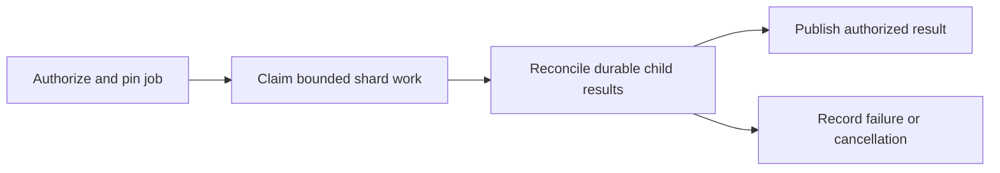

# Import and export

**Status:** Proposed. Pending maintainer review.

## Purpose and scope

Run bulk data jobs asynchronously across FHIR R4 shards. The federation owns authorization, job state, placement, and the aggregate result. Shard adapters use native bulk operations through certified [v1 backend profiles](../superpowers/specs/2026-11-19-fhir-federation-service-design.md#92-backend-profiles). Export and import have separate opt-in switches and roles. No distributed commit, server-side de-identification, or synchronized cross-shard export snapshot is promised.

## Job contract

Kickoff returns `202 Accepted` and a federation `Content-Location` of `[base]/bulk/jobs/{id}`. `GET` on that location returns `202` and `Retry-After` while work is pending and `200` with the authorized terminal result on full success. A failed export returns a sanitized terminal `OperationOutcome` and never a success manifest. An import that made partial progress returns a terminal `409` with an `OperationOutcome` and an authorized reference to a structured result summary. `DELETE` requests cancellation; it does not roll back committed imports. `GET` after expiry returns `410` to the authorized owner while the expiry record is retained. A caller who cannot access the job gets a uniform not-found response after authentication.

Bind the job to its initiating identity, effective grants, normalized input, storage policy, and registry generation. Authenticate and authorize each poll, cancellation, resume, and manifest access. Recheck the grant and the topology pin before publishing a result. Use a durable coordinator state record and separate child records per shard or chunk. Workers claim jobs through expiring leases, but leases alone never authorize repeated mutations. Begin with configurable limits for parallel shards, jobs per caller, file count, input bytes, line length, attempts, and duration. Enforce limits during streaming rather than trusting declared lengths.

## Federated export

Accept `GET [base]/$export`, `GET [base]/Patient/$export`, and `GET [base]/Group/{id}/$export` with `Prefer: respond-async`. Certify `_type`, `_since`, and NDJSON output per backend and export scope. Reject unsupported options instead of dropping filters. If `_type` is supplied, require the caller's export grant for every requested type. Otherwise explicitly send exactly the caller's authorized export types. Reject the request if a backend cannot enforce that set. Any required Patient or Group membership capability must also be authorized.

Freeze the participating visible shards at kickoff and schedule export on each. For system and patient export, use the corresponding native operation. v1 Group IDs are server-scoped: `{id}` on its own cannot identify the same Group on every shard. For group export require a federation-admin registered export scope for that selector with an exact membership mapping for every participating shard, including explicit empty memberships with proof. The selector is a job parameter, not a shard-less Group read. If a scope cannot represent cross-shard members or relevant patient-compartment data exactly through certified native calls, reject the request. Never assume that the same Group ID on two shards means the same population. Patient export likewise requires proof of complete compartment coverage for the requested native semantics.

Poll child operations with each shard's profile and credential. Treat kickoff timeouts as unknown until the profile can correlate the returned job or confirm non-submission. Publish one manifest after all children succeed. Include the request without secrets, `transactionTime` equal to the earliest certified shard watermark, `requiresAccessToken: true` for storage authentication, and `output` and `error` entries. Every file entry carries its resource type, immutable approved storage URL, and source shard alias and base URL via a documented federation manifest extension. Include each shard's own watermark. Keep NDJSON files separate; `(sourceShard, resourceType, id)` disambiguates records and resolves relative references. Do not advertise a globally consistent `_since` cursor or a snapshot of all shards. If the profile cannot certify a watermark or distinguish a native error file from full success, do not claim a completed federated export.

Clients download bytes directly using their own storage identities and narrowly scoped grants. Keep staged objects inaccessible to callers until all shard results and the caller's current grant pass publication checks. The federation never proxies the files or exposes backend credentials, storage bearer URLs, or signed query strings. The storage grant and job result expire. Require a storage policy that can revoke future access on cancellation or loss of eligibility, with a documented upper bound on revocation delay. Revocation cannot recall files already downloaded. A transient shard error gets a bounded retry for proven safe polls. A permanent failure, native partial result, or pin expiry fails the job and quarantines staging output for bounded cleanup. See [V5](decisions.md#v5).

## Federated import

Accept `POST [base]/$import` with a FHIR `Parameters` manifest of approved immutable NDJSON inputs and a proposed import mode. Require a kickoff idempotency key and bind the request to object versions and digests, not just URLs. The default is create-only. Start with native import into fresh or exclusively fenced shards; enable routed import into existing placements only when the profile certifies create-only enforcement and commit reconciliation. Never use silent upserts as a fallback.

1. Validate file identity and limits, then stream into encrypted staging. Validate each resource, derive its placement through the [write router](write-placement.md#placement-and-routing), and reserve its exact target identity. A backend-generated ID is not safe for a bulk replay; require preserved explicit IDs.
2. Resolve references against the planned destination. Relative references must name a target on the same destination shard or in a certified dependency on an admitted local chunk. Preserve valid known absolute references. Reject a relative reference that would cross shards rather than guessing an owner or rewriting it. Unknown absolute references are not fetched. Reject unsupported passthrough paths and unresolved dependencies. If a dependency group cannot be committed safely within a bounded chunk, reject or stage it as a migration job.
3. Group by shard, placement, and epoch. Seal bounded chunks with deterministic IDs derived from job ID, placement, object version, and chunk digest. Reject duplicate target identities within the job and occupied target identities by default. The same resource ID on another shard is not a collision. A proven prior commit of the same chunk is a replay, not an accepted new collision.
4. Submit each frozen chunk using a separately scoped native import identity. The profile must establish job and commit attribution and declare its row-level versus chunk-level atomicity. Record per-resource or per-chunk receipts before advancing. After a timeout, resume from certified receipt or equivalent proof, not by resubmitting unknown records.
5. On partial failure retain successful commits, stop dependent chunks, and surface counts and sanitized error codes. Resume only failed work with a proven safe state. Explicitly replan unstarted chunks under the new generation after a move; preserve committed and unknown chunks and revalidate their dependents.

An approved storage origin is not permission to read every object at that origin. Require the caller's import grant and separate proof that the caller can use each input object. Resolve only provisioned storage paths, and recheck object version and source authorization before staging or resuming.

Expose resume as `POST [base]/bulk/jobs/{id}/$resume` for the same authorized job owner, with a durable resume key. It returns `202` only if eligible work can proceed. Correcting input creates a new job linked to the prior receipt; it does not replace an immutable input in place. See [V4](decisions.md#v4) and [V6](decisions.md#v6).

## Governance and failure modes

Treat source URLs, storage redirects, backend job URLs, filenames, and manifests as untrusted. Use provisioned storage origins and path policies, pinned object versions, protected credentials, and no redirect following. Store the minimum job metadata and separate encrypted, access-controlled working data from durable receipts. Audit the caller, effective grant, job and shard IDs, policy version, bytes and counts, transitions, and expiry. Do not log bodies, patient identifiers, or sensitive URI components. Apply retention, region, residency, and legal-hold policy to both the staging and published data. The [v1 security contract](../superpowers/specs/2026-11-19-fhir-federation-service-design.md#10-security) still applies to all read paths.

| Edge case | Action |
|---|---|
| Unknown or unsupported backend scope | Reject before kickoff; return `400` for unsupported parameters and `501` for unsupported operations. |
| Lost grant after kickoff | Stop pending work where possible, withhold manifests, revoke download access, and audit. Committed writes remain. |
| Cancel during a native operation | Request backend cancellation. Keep `cancel-pending` until proved terminal; preserve partial writes and unknown state. |
| Registry changes before a pinned job finishes | A move and the job coordinate through bounded pins. Fail a blocked export, or pause import after reconciling active chunks. |
| Input digest changes, storage policy mismatch, or output origin rejected | Fail without following redirects, publishing results, or retrying under different grants. |
