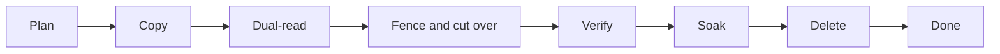

# Shard rebalancing

**Status:** Proposed. Pending maintainer review.

## Purpose and scope

Change a shard's participation or move an explicit placement unit under operator control. An ownership change has one atomic publication point. A data copy is not a new owner. The first release adds empty shards, then supports a certified whole-shard replacement behind the same real shard URL. A later release can change identities under the gates below. Continuous balancing, transparent logical URLs, automatic reference rewriting, and zero downtime are non-goals.

See v1 [identity and registry](../superpowers/specs/2026-11-19-fhir-federation-service-design.md#4-identity-and-references), [execution](../superpowers/specs/2026-11-19-fhir-federation-service-design.md#7-execution), and [security](../superpowers/specs/2026-11-19-fhir-federation-service-design.md#10-security).

## Operations and admission

| Operator operation | Proposed plan |
|---|---|
| Add a shard | Certify an empty shard, confirm none of its origins or aliases can rebind an existing absolute reference, append its ordinal, and publish it as an eligible owner for new keys. Do not move existing assignments. |
| Replace a shard | Copy to a detached replacement server, then switch the backend behind the same real client-visible `BaseUrl`. Rehearse routing and rollback before cutting over. Require preserved versions and modification timestamps; ordinary export followed by import is not proof of either. |
| Drain and remove a shard | Mark it ineligible for new keys. Move all owned units. Remove from read membership only after census shows no remaining authoritative data. Keep retired-origin and alias records. Never treat an unreachable shard as empty. |
| Split a shard | Stage a replacement containing the staying units and one or more fresh shards for the moving units. Publish membership and placement together. |
| Merge shards | Stage a detached union, check destination ID collisions and reference closure, then publish the union and retire the former owners. |
| Move a tenant or partition | Move an entire placement unit and prove reference closure. Use detached replacement shards if needed. A tenant here is a placement unit, not an isolation boundary. |

Detached membership is the default means of hiding staged copies. Reject an in-place move into a serving shard unless the profile can enforce visibility before every query, count, join, reference read, download, and direct read, and fence writes to the exact partition. A tag on the copied resource or filtering a merged result does not meet that contract. For a profile that cannot preserve metadata, verify reference closure, or guarantee a fence, leave the affected move unavailable. See [V7](decisions.md#v7).

## Registry and token contract

Keep the v1 registry hash fields. For vNext topology control, add a monotonically increasing registry generation, a backing epoch per shard, and a placement epoch per managed unit. A same-URL replacement advances the backing epoch. Every serving membership, backing endpoint, or effective placement-policy change advances the generation in the same compare-and-swap publication as the new ownership. Never reuse an ordinal, alias, or retired origin for another shard. Seed explicit ordinals from v1 positions, append new ordinals, and leave holes after removal. Sticky directory inserts for new keys are not topology changes.

Readers acquire a bounded generation lease before accessing a shard. Before switching topology, stop admitting old leases and drain granted requests within their bounds. An instance that cannot prove a current lease fails closed, not ready. When generation mode is on, a valid, caller-bound continuation from any other generation or from legacy format returns `410`, even if the changed shard is not in the token's streams. Require a new search. Keep v1's token binding, encryption, lifetime, cursor re-execution and vanished-key rules. **This intentionally tightens v1 section 7.4 only in enabled mode.** See [V8](decisions.md#v8).

## Move state machine

Persist `MoveId`, source and destination, expected generation, selected units, checkpoints, receipts, desired state, and last proven transition. Checkpoint stable chunk IDs and digests before dispatch; verify what the destination actually committed before advancing. Reserve overlapping ownership units by compare-and-swap; independent copy workers have separate checkpoints. Each transition checks its prerequisites on resume. A job that cannot prove them pauses with a reason or enters `RecoveryRequired`.

| State | Advance only when | Stop or recover |
|---|---|---|
| Plan | Owners, capacity, fences, profile proofs, retention, recovery plan, and reference closure pass preflight. | Stop without side effects. |
| Copy | A bounded base copy and its checkpoint are verified on the detached destination. Track updates and deletes to a certified high-water mark, or fence before a full copy. | Keep source authoritative. Reconcile or quarantine the destination. |
| Dual-read | Internal verification reads compare source and destination by explicit move-map membership. Count, content, version, and reference checks match at a declared watermark. Only source is publicly visible. | Pause and recopy drift; drop staging if cancelled. |
| Fence and cut over | Stop old admissions, enforce backend write fence, settle all unknown writes and native jobs, apply final changes, and drain old read leases. Confirm destination write fence. Publish source-to-destination ownership, tombstones, and generation in one compare-and-swap. | Before publication, keep the old owner and lift its fence only after reconciliation. If publication result is unknown, reread the registry and reconcile before lifting any fence. |
| Verify | Run targeted identity, count, chain, include, and sort checks against the published generation; confirm no source is still publicly authoritative for moved identities. Destination writes remain blocked. | If verification fails and destination writes are provably absent, fence again and publish a new generation pointing to source. Never reuse the old generation. |
| Soak | Keep the old copy inaccessible and recoverable. Recheck drift, references, alerts, and audit evidence; open destination writes after approval. | Once any destination write may have happened, rollback means a new reverse move that reconciles those writes, never flipping ownership back to a stale source. |
| Delete | Retention and legal holds allow deletion; source ownership, backups, expected versions, and lease and job drain are proved. Require separate destructive approval. | Stop on a comparison mismatch. Resume verified deletion by receipt; after deletion, recovery uses a backup or a new move. |

A registry epoch is not a backend fence. An old dispatched request can finish after the federation stops admission. Require a backend-enforced fence for all write paths, including direct writes and native import. Where a whole-shard read-only mode or role revocation is the fence, verify propagation and confirm that all previously accepted backend work reached a terminal or reconciled state. A `403` probe alone does not prove that earlier work has stopped. If the profile cannot prove quiescence, do not cut over. See [V9](decisions.md#v9).

For same-URL replacement, operate a controlled ingress for the public shard URL. During publication, fail affected direct requests closed until the ingress route and registry generation agree. Drain existing direct requests under an operator-bounded maintenance window. Any separate connect origin must match the shard's configured and certified HTTPS scheme, host, port, and base path. Never add an origin from an observed response or redirect. If the operator cannot hide both the detached destination before publication and the retired source afterward, the topology is ineligible.

| Concurrent work | Copy and dual-read | Fence through verification |
|---|---|---|
| Online writes | Source only, if a certified delta captures creates, updates, and deletes. Otherwise fence first. | Block both sides until opening the verified destination. |
| Import | Can run only before a fence reservation for the same unit, under a bounded pin. | Pause undispatched chunks and wait for terminal native jobs. Unknowns block publication. |
| Export | Read only the pinned public membership. Hidden destinations are excluded. | Stop admitting conflicting pins. Let bounded pins finish or fail the export without releasing a manifest. Cancel or drain the underlying backend reads before swapping; expiry of the federation job is not proof they stopped. |

## Identity, duplicates, and references

A relocation changes `(shard, type, id)` and the real `fullUrl` under D1. Never return the destination body as if it still lived at the old URL. Preserve old origin mappings and aliases as retired records. At the federation-qualified route, return an authorized `410` with no `Location` redirect. A direct request to a backend URL follows that server's own retirement policy; if the operator controls the retired host, it should return `410`, not redirect. Do not follow backend redirects or reuse retired qualified identities. Do not surface the target in a tombstone response. Protect migration mappings like data and keep them for the documented reference and retention window.

Before moving an identity, prove there are no relative references across the move boundary in either direction and no absolute inbound references to retired identities. Ensure the target will not capture previously dangling relative references or change the meaning of moved relative references. Check target collisions; a same-ID resource on another shard remains distinct under D1. If replicated reference data is required, require certified equivalent content. Keep versioned references and passthrough assertions exact. Without a trusted reverse-reference index or a write policy that proves closure, scan all affected shards over a bounded census and verify it again at the fence. An unprovable closure blocks the move.

The public merge and exact count receive only the authoritative copy. Maintain v1 section 7's sorted order and cursor keys: `(lastUpdated, shardOrdinal, positionInStream)` orders the stream heads, and `(lastUpdated, type/id)` is a sorted stream's resume key. Neither key proves that two servers contain a replica. For per-page include deduplication, retain the v1 section 7.6 identity key `(shard, type, id, versionId)`. In the **internal** dual-read comparison, suppress a known replica only by mapping its exact destination identity and copied version to the source key, then aggregating once per source key. The move map provides the proof, not a matching unqualified key or timestamp. Do not use this comparison as a fallback for public counts or queries. See [V10](decisions.md#v10).

## Operator interface and runbook

Propose an admin API on a separate audience and listener, with `POST /admin/moves` to return a dry-run plan, `GET /admin/moves/{id}` for state, and `POST /admin/moves/{id}/actions` for approved start, pause, resume, abort, and delete. Each mutation requires an operator grant, a stable command key, and the expected generation or state version. The CLI calls the same API. A protected audit sink records who approved and executed each phase. The data plane never receives mover credentials.

- Verify backend profiles, available capacity, the placement census, reference closure, and the rollback plan before start.
- Inspect lag, digest mismatch, unknown writes, and active pins before approving cutover.
- Verify generation on all ready readers, old-token `410`, exact totals, and both reference directions before opening destination writes.
- Verify soak evidence, backups, legal holds, and decommission approval before deletion.

Trace moves by move ID, generation, phase, and shard alias. Measure pending native work, unresolved write receipts, copy and delta lag, verification mismatch, lease age, token `410` rate, and recovery age. Use bounded-cardinality labels and omit resource content and placement keys from metrics. The prior Well-Architected Distributed Sharding review motivates explicit failure, authorization, tracing, and memory gates.

| Failure | Operator response |
|---|---|
| Destination unavailable before publication | Pause staging. Continue at source only if the existing fence policy allows it. |
| Source unreachable or loses fence proof | Stop publication and alert. Do not infer completion or promote stale data. |
| Old reader keeps serving or registry quorum is lost | Fail readiness. Do not delete or expose a second owner. |
| Unexpected identity or reference drift | Keep writes blocked and reconcile. Roll forward or publish a verified rollback generation. |
